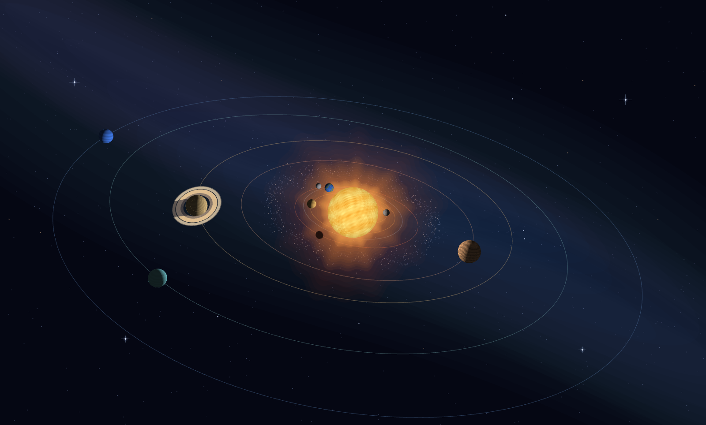

# TMC with Classes (TMC++)

**Desmos graphs as code, with classes.** TMC++ is a preprocessor for [DesModder](https://www.desmodder.com/)'s Text Mode (TMC): it adds CSS-style classes, one-word styles, labels, slider shorthand, reusable components, conditionals, action shortcuts and libraries, then compiles to plain TMC. A browser extension compiles it live inside desmos.com, a VS Code extension checks it as you type, and an [MCP server](#mcp-server) lets AI apps write graphs straight into your Desmos tab.

The name is a nod to C++, which started life as "C with Classes".

[](docs/event-horizon.png)

*`examples/event-horizon.tmcpp`, written by ChatGPT in TMC++: a tilted accretion disk, lensed light, orbiting embers and poster typography, all equations. 104 lines, 71 Desmos items. Click for the full-resolution still.* [See Desmos graph.](https://www.desmos.com/calculator/91wpdzmsmn)

[](docs/solar-system.png)

*`examples/solar-system.tmcpp`, written by ChatGPT through the [MCP server](#mcp-server) from a one-line prompt: the planets at their real positions for the chosen date (JPL's Keplerian elements, Kepler's equation solved with Newton steps), shaded spheres ray-cast against the Sun, Saturn's rings with the planet's shadow, and a free-flying camera on sliders. 349 lines, 304 Desmos items, rendered here with `tmcpp preview`.* [See Desmos graph.](https://www.desmos.com/calculator/izcqxxc7au)

```js
class curve { #c74440 dashed width 3 }

"Parabola demo"

folder "Controls" collapsed {
  p = 2  [0.1 : 10 : 0.1]
}

folder "Curves" {
  y = x^2 / (4p)   .curve
  (0, p)           #blue point 12 drag y  label "focus" right
  y < sin(x)       .curve fill 0.3
}
```

The same graph in plain TMC needs a nested `@{ }` style block on almost every line. If you already know TMC, most of it works as is, and a raw `@{ ... }` is always accepted. The exceptions come from TMC++'s line rules: put each statement on its own line (no one-line folders like `folder "A" { y = x; }`), and start a style block on the same line as its math.

## Install

```sh
npx @ikeasourpatches/tmcpp graph.tmcpp        # compile once, nothing to install
npm install -g @ikeasourpatches/tmcpp         # or install the tmcpp command
tmcpp graph.tmcpp > graph.tmc
tmcpp check graph.tmcpp                       # compile, then validate with DesModder's parser
tmcpp check graph.tmcpp --runtime             # ...and load it in real Desmos: what Desmos itself rejects
tmcpp describe graph.tmcpp                    # sliders, functions, components and what imports bring in
tmcpp fmt graph.tmcpp --write                 # tidy indentation and blank lines (--check for CI)
tmcpp preview graph.tmcpp --out graph.png     # render in real Desmos (see below)
```

`check --runtime` catches what the parser can't: `Cannot add a point and a number`, and helper point lists that get drawn by accident. Each problem names its TMC++ line, and the slider values it was checked at; `--at a=1 b=pi` sets sliders first, and `--json` gives the result as JSON for tools and editors. It uses the same browser as preview.

Preview and `check --runtime` need `playwright-core`, an optional extra that drives the Chrome or Edge you already have. Add it next to tmcpp with `npm install -g playwright-core`, or in one go: `npx -p @ikeasourpatches/tmcpp -p playwright-core tmcpp preview graph.tmcpp`.

Needs Node 20 or newer. In code: `import { compile } from "@ikeasourpatches/tmcpp"`.

`check`, `preview`, `mcp` and `pair` arrive in 0.3.0. Until that version is on npm, run them from a checkout (below).

| Where | Get it |
| --- | --- |
| Command line and Node | [npm: `@ikeasourpatches/tmcpp`](https://www.npmjs.com/package/@ikeasourpatches/tmcpp) |
| VS Code | [VS Code Marketplace: TMC++](https://marketplace.visualstudio.com/items?itemName=IkeaSourPatches.tmcpp), or search "TMC++" in the Extensions view |
| Cursor, VSCodium, Windsurf | [Open VSX: TMC++](https://open-vsx.org/extension/IkeaSourPatches/tmcpp) |
| Desmos in Chrome | the [browser extension](#browser-extension), loaded unpacked for now |

## Quick start

Working on TMC++ itself needs Node 22 or newer (the tests use its built-in WebSocket).

```sh
npm install
npm test                                  # compiler and DesModder parser tests
node src/cli.js examples/sunset.tmcpp        # print TMC, or errors with line numbers
node src/cli.js check examples/sunset.tmcpp  # compile, then validate with DesModder's parser
```

In a checkout, `node src/cli.js` is the `tmcpp` command. It also reads TMC++ from standard input when no file is given. `check` accepts either a `.tmcpp` source file or an already compiled `.tmc` file. Compile diagnostics identify source lines; parser diagnostics from `check` identify lines in the generated TMC.

To check a file with imports, pass the entry file; every command resolves relative files and `gh:` or HTTPS imports. For example, `tmcpp check examples/springs-import.tmcpp` checks the spring library together with the graph that imports it. (`tools/check.js` and `npm run preview` still work and run the same code.)

### Preview in real Desmos

```sh
tmcpp preview examples/glass-choir.tmcpp                          # one frame -> glass-choir.preview.png
tmcpp preview examples/glass-choir.tmcpp --at a=1.2 d=-0.5        # set sliders first
tmcpp preview examples/glass-choir.tmcpp --sweep a=0..2pi/9       # 9 frames of a loop as a contact sheet
tmcpp preview examples/hello.tmcpp --sweep s=0..=1/5 --out hello.png   # ..= includes the end value
```

The parser only proves the equations are valid; the preview shows the composition, such as a moving shape crossing a title at some slider values. It renders with Desmos itself (`Calc.asyncScreenshot`) in your installed Chrome or Edge, headless, so it needs internet access to desmos.com but no extra browser download. Add `--show` to watch it, `--width` and `--cols` to size the output.

Paste the printed TMC into DesModder's Text Mode (the T button above the expression list), or use the extension below.

## MCP server

`tmcpp mcp` runs a [Model Context Protocol](https://modelcontextprotocol.io) server on stdio, so an AI app such as Claude Code, Claude Desktop or Cursor can write TMC++, check it and see what it made. It offers three tools and some reading material:

| | |
| --- | --- |
| `compile` | TMC++ to TMC, or compile errors with line numbers |
| `check` | compile, then validate with DesModder's parser; fast, no browser. With `runtime: true` (and `at` slider values), also load it in real Desmos and report what Desmos rejects, by TMC++ line |
| `describe` | sliders with ranges, functions and components with their parameters, classes, colours, and what each import brings in |
| `preview` | a PNG from real Desmos, with `at` slider values or a `sweep` contact sheet (needs `playwright-core`) |
| `tmcpp://docs/syntax` | the whole syntax reference at once; `tmcpp://docs/syntax/components` and so on for single pages |
| `tmcpp://std/...` | the source of each built-in library |

Each tool takes `source` (the text) or `file` (a path; relative imports resolve next to it).

### Linking your Desmos tab

With the browser extension linked, the AI can also work in the Desmos tab you have open:

| | |
| --- | --- |
| `link_status` | linked or not, and the pairing code if not |
| `push` | put TMC++ in the panel and compile it into your graph (undo in Desmos brings the old graph back; the old panel text is kept) |
| `pull` | TMC++ rebuilt from the graph as it is now, edits you made in Desmos included, or the panel's text |
| `screenshot` | a PNG of the tab as it is right now |

To pair, run `tmcpp pair` in a terminal (or ask the AI for `link_status`), then in Desmos open the TMC++ panel, choose ⋯ > **Link to AI**, paste the code and press **Link**. A green **AI** badge shows while it's linked. Pairing is done once: the code is kept in `~/.tmcpp/link.json`, and the extension remembers it.

The link is up only while the AI app is running `tmcpp mcp`. Until then the panel says "Waiting for tmcpp mcp", and Chrome's extension console shows `ERR_CONNECTION_REFUSED` now and then as the extension retries (every 3 to 30 seconds). That's expected and harmless.

How it's kept safe: `tmcpp mcp` listens only on `127.0.0.1` (port 51324, or `TMCPP_LINK_PORT`), accepts only browser extensions (web pages can't connect), and drops any connection that doesn't send the pairing code within 5 seconds. **Unlink** in the panel turns it off; `TMCPP_LINK=0` starts the server without it.

Claude Code:

```sh
claude mcp add tmcpp -- npx -y -p @ikeasourpatches/tmcpp -p playwright-core tmcpp mcp
```

Claude Desktop, Cursor and other apps with a JSON config:

```json
{
  "mcpServers": {
    "tmcpp": { "command": "npx", "args": ["-y", "-p", "@ikeasourpatches/tmcpp", "-p", "playwright-core", "tmcpp", "mcp"] }
  }
}
```

On Windows, use `"command": "cmd", "args": ["/c", "npx", ...]` if the app can't start `npx` directly. From a checkout, point it at the source instead: `claude mcp add tmcpp -- node /path/to/tmcpp/src/cli.js mcp`, or `"command": "node", "args": ["/path/to/tmcpp/src/cli.js", "mcp"]` in a JSON config. Drop the `playwright-core` part if you don't want previews. `claude mcp remove tmcpp` undoes the add.

## Browser extension

1. `npm install`, then `npm run build:ext` (writes `extension/dist/tmcpp.js`).
2. In Chrome open `chrome://extensions`, turn on Developer mode, click **Load unpacked** and pick the `extension` folder.
3. Open desmos.com/calculator and click **TMC++** (bottom right) or press Alt+T.
4. Write TMC++ and press Ctrl+Enter. The whole graph is replaced; Ctrl+Z in Desmos undoes it (two presses). Inside the editor, Ctrl+Z undoes your typing as usual.
5. Or press **Live** in the panel's header: the graph then updates as you type, a moment after you stop, whenever the file has no errors. Only the lines you changed are updated, so sliders you've dragged keep their values and the view stays where you panned it; adding or removing lines reloads the graph but keeps both. Live updates don't fill Desmos's undo history.

The panel:

- the editor highlights TMC++ (classes, colours, style words, `${}` in labels, keywords), underlines compile errors and warnings while you type, and completes class names after `.`, colours after `#`, components after `new` (imported ones too, `sp.Spring`), style words in a tail, your variables, and library names inside `import "`. Ctrl+Enter compiles, Ctrl+/ comments lines, Ctrl+F searches, and Tab indents
- hovering a name explains it: a function's or variable's definition, a component's parameters and members, an instance, a class's tokens, a colour, a style word, an enum member's value, or what an import brings in
- after `s1.` it offers that instance's parameters and locals; after `sp.` what the import offers; after `P.` a point's `x` and `y`
- F12 or Ctrl+click (Cmd+click on a Mac) goes to a definition; F2 renames a name everywhere it means the same thing (a component's parameter is renamed in its body, in named arguments and in `s1.coils`); Shift+Alt+F, or ⋯ > **Format**, tidies indentation and blank lines
- the header has **From graph**, **Library** (with a count of saved libraries, orange when an import needs fetching), a **⋯** menu (Open, Save, Copy TMC, Link to AI, Example) and **Compile**
- lists errors by TMC++ line, from both the compiler and the TMC parser; click one to jump to it
- **Open** loads a `.tmcpp` file and compiles it (or drop the file onto the editor); **Save** downloads the editor text as `<graph-title>.tmcpp`
- **Example** loads a hello-world that writes itself; **Copy TMC** copies the compiled TMC
- **Library** saves definition-only source for reuse, inserts imports, and fetches GitHub libraries for offline use
- **Link to AI** pairs the tab with `tmcpp mcp` (see [Linking your Desmos tab](#linking-your-desmos-tab)); a green **AI** badge in the header, and **TMC++ · AI** on the toggle button, show it's linked
- saves your source per graph in the browser and follows you when you switch graphs
- **From graph** rebuilds TMC++ from the graph as it is now. Untouched lines come back exactly as you wrote them; lines you restyled in Desmos come back as their classes plus only the changed tokens (`.curve width 5`); math edited in Desmos is converted back; component instances, `if` blocks and imports come back as written while untouched; items added in Desmos appear without their automatic colour. Opening a TMC++ graph this browser has no source for rebuilds it automatically.
- watermarks the graph: its hidden `randomSeed` starts with `544d432b2b`, which is "TMC++" in ASCII hex, and is kept across recompiles so `random()` doesn't reshuffle (a seed you set in `settings` always wins)
  - Desmos hashes randomSeed with MD5 per expression; thanks to MD5's avalanche effect, the fixed prefix has zero impact on randomness quality as long as the remaining 80 bits vary with your source.
- writes a hidden metadata note into the graph (classes, tags, tails, comments, hashes) so the graph remembers it was made with TMC++, and pops the panel open when you open such a graph

After changing the compiler, run `npm run build:ext` again and click reload on the extension card, then reload the Desmos tab. Reloading only the tab keeps Chrome's old background worker, and the panel then says to reload TMC++ in `chrome://extensions`.

## VS Code

[`vscode/`](vscode) is a VS Code extension for `.tmcpp` files: syntax highlighting, compile errors and warnings underlined as you type (imports resolve from disk, GitHub and `std/`), hover docs, member completion after `s1.`, go to definition (into library files on disk too), rename (F2), Format Document, and the commands **TMC++: Show compiled TMC** and **TMC++: Copy compiled TMC**. Install it from the [VS Code Marketplace](https://marketplace.visualstudio.com/items?itemName=IkeaSourPatches.tmcpp) or, for Cursor and VSCodium, [Open VSX](https://open-vsx.org/extension/IkeaSourPatches/tmcpp). To build it yourself, run `npm run build:vscode`; publishing steps are in [vscode/README.md](vscode/README.md).

## Language

The essentials are below. **Everything else is in the [syntax reference](docs/syntax/README.md)**, one short page per topic: [lines and math](docs/syntax/basics.md), [conditionals, actions and enums](docs/syntax/logic.md), [styles](docs/syntax/styles.md), [components](docs/syntax/components.md), [libraries](docs/syntax/libraries.md), [blocks and settings](docs/syntax/blocks.md), [From graph](docs/syntax/round-trip.md) and [errors](docs/syntax/errors.md).

- **One statement per line**; a `;` is optional, and a line ending in an operator, a comma or an open bracket continues on the next. `//` comments are allowed anywhere.
- **Write math naturally**: `4p`, `k sin(x)` and `2|x|` get their `*`, and names like `score` become names Desmos accepts.
- **A tail styles a line**: it starts at the first `.class`, `#colour`, lone `.`, `label "`, `click(` or `@{` after a space. Later tokens win.

```js
class curve { #c74440 dashed width 3 }      // a reusable style
color sea #2d70b3                            // a named colour, used as #sea
a = 1 [0 : 2pi] . play loop 10s              // a slider: bounds, then playback
y = sin(x + a)  .curve opacity 0.5           // a class, then an override
(0, 1)  #sea point 10 drag y label "P" above
let M = (a, 0)                               // a helper: used, never drawn
score = 0
mode = enum(idle, flying)                    // named states
M . click(score++, mode++)                   // actions
y = if mode = flying then 2 else -2          // an inline if
```

The most used tokens: `solid` `dashed` `dotted`, `width N`, `opacity N`, `fill N`, `point N`, `drag x|y|xy`, `hidden`, `label "text"` with a position (`above`, `below-left`...), slider bounds `[min : max : step]`, and `play` `loop` `bounce` `once`. The full list is on the [styles page](docs/syntax/styles.md#token-reference).

Bigger structure, each with its own page:

```js
component Dot(P, abstract n = 0) {           // components: written once, stamped out with new
  P . point 12 click(n++) label "${n}"
}
new Dot((2, 1)) as d1
import "std/ui" as ui                        // libraries: files, GitHub, or the built-in std/
folder "Controls" collapsed {                // folders, tables, tickers, settings
  k = 2 [1 : 5 : 1]
}
```

## Examples

| File | What it shows |
| --- | --- |
| `examples/night-net.tmcpp` | NIGHT NET, a playable game: drag the net to catch falling gold stars and let the red meteors drop. A ticker runs the game loop, a clickable PLAY button (`@{ onClick: start }`) resets it, and it tracks lives, score and best score |
| `examples/glass-choir.tmcpp` | THE GLASS CHOIR (by ChatGPT): a deep-sea dive with a sonar ping, 13 lanternfish that light up as the echo passes, a glass jelly and a submarine; uses a 19-colour `color` palette, one list inequality for 24 water bands, and `segment()` for the coral (232 items) |
| `examples/event-horizon.tmcpp` | EVENT HORIZON (by ChatGPT): a black hole poster with a lensed photon ring, a disk that passes in front of the shadow (`max(..., v) < 0`), 12 glowing embers on one slider, and label typography |
| `examples/solar-system.tmcpp` | the solar system in 3D (by ChatGPT, through the MCP server): real orbits from JPL's elements for any year from 1800 to 2050, ray-cast shaded planets, Saturn's rings and shadow, the asteroid belt, and a camera you can orbit, fly and roll with sliders |
| `examples/hello.tmcpp` | HELLO WORLD written stroke by stroke from 46 segments and one parametric expression (the extension's starter) |
| `examples/daycycle.tmcpp` | a looping 24-hour day over the sea: the sun and moon on opposite arcs, stars, dawn and dusk glow |
| `examples/sunset.tmcpp` | a sunset scene driven by one time-of-day slider |
| `examples/demo.tmcpp` | a parabola with a draggable focus |
| `examples/parallax.tmcpp` | PARALLAX, a tesseract projected into 2D, built with `std/ui` and action shortcuts: click any vertex to send a pulse along the edges |
| `examples/wire-cube.tmcpp` | a wireframe cube from `std/3d`, with yaw, pitch and roll sliders to show the rotation order |
| `examples/prism-post.tmcpp` | PRISM POST, a seven-route pulse-routing puzzle. Rotate the brass mirrors, then dispatch a pulse through both diamond stamps and into the cyan mail slot. The first six routes use eight mirrors; the final route adds seven more. `Mirror` and `Stamp` components track each mirror's turns and each stamp's state, while a ticker advances the pulse. The counter shows turns and par; returned pulses can be retried, and **Reset** clears the current route. |
| `examples/springs.tmcpp` | two instances of a reusable spring component with local variables and an instance style override |
| `examples/springs-import.tmcpp` and `examples/lib/springs.tmcpp` | the same spring component moved into a relative library and imported as `sp` |

## How it works

```
TMC++ --compile--> TMC --text-mode-core textToRaw--> Desmos state --Calc.setState--> graph
```

Imports are resolved first: from disk and GitHub in Node (`src/load-node.js`), from the Library panel in the extension. `text-mode-core` is DesModder's own Text Mode library, bundled in `vendor/`.

Going back, `src/decompile.js` rebuilds TMC++ from a graph state using the metadata note, recompiling each tail to compare it with what Desmos holds, and `src/latex.js` turns Desmos LaTeX back into TMC math.

The compiler (`src/compile.js`) is a line-based preprocessor. It rewrites some math syntax, including implicit multiplication and restrictions, before text-mode-core parses the generated TMC. Components, `if` blocks, actions and imports are separate passes (`src/components.js`, `src/conditionals.js`, `src/actions.js`, `src/imports.js`). In the extension, items then get stable ids (`t1`, `t2`, ...) and a secret metadata note records what Desmos can't hold (`src/meta.js`).

The MCP server (`src/mcp.js`) and its link to the extension (`src/link.js`, a small WebSocket server on 127.0.0.1) use no outside libraries.

## TMC information

TMC++ bundles its own build of DesModder's Text Mode library (`vendor/text-mode-core`, from DesModder's source, November 2026), because the npm release stopped at 0.1.1 in 2023. So `|x|`, regression parameters (`#{ m = 1, b = 2 }`) and the `id` option all work. Two things plain TMC still doesn't read, which TMC++ handles itself (see the syntax reference): Greek letters other than `alpha beta theta phi pi tau`, and restrictions like `y = x {x > 0}`.

## Roadmap

v3 is the finished product: M21, M20 and the M14 eval come next, and then the browser extension goes on the Chrome Web Store (M15). Until then, a dev build of the extension is on the [releases page](https://github.com/IkeaSourPatches/tmcpp/releases).

| Milestone | State |
| --- | --- |
| M1 line compiler | done |
| M2 classes, inline styles, labels, settings, playback, tables, tickers | done |
| M3 browser extension with live compile, stable ids and the metadata note | done |
| M4 decompile: rebuild TMC++ from a graph, with Desmos UI edits as inline overrides | done |
| M5 components: `component Spring(A, B) { ... }` and `new Spring(...) as s1` | done |
| M6 components inside components, `p.a.n` paths, stacked tails | done |
| M7 list instances: `new Cell(i, j) for i = [1...9], j = [1...9] as cells` | done |
| M8 round trip: "From graph" gives back `new` lines, `if` blocks, imports and component definitions | done |
| M9 inline and block [if statements](docs/syntax/logic.md#conditionals) | done |
| M10 merged ticker actions (`tick` in components) | dropped, not doing it |
| M10 [scientific notation](docs/syntax/basics.md#scientific-notation): `3e-3`, `1.5E8` | done |
| M11 ship v2: version 0.2.0, changelog, packaged extension and VS Code extension | done |
| M12 [libraries](docs/syntax/libraries.md): `import`, the Library panel, GitHub imports, built-in `std/styles`, `std/ui`, `std/shapes`, `std/easing`, `std/3d`, `std/color`, `std/orbits` | done |
| M13 npm CLI: `tmcpp check`, `tmcpp preview` | done |
| M14 [MCP server](#mcp-server) with the Desmos tab link | done; an eval of how well AI models write TMC++ is next |
| M15 Chrome Web Store, and publishing from CI: the v3 release | last, after the rest of v3 |
| M16 editor smarts: hover docs, member completion, go to definition, rename, `tmcpp fmt`, in the panel and VS Code | done |
| M17 language additions: `let`, enums, private library names | done |
| Checks: wrong argument counts and constant parameters at compile time, `check --runtime` in real Desmos, `describe` | done |
| M18 current Text Mode, bundled: `\|x\|`, regressions, `id` | done |
| M19 `fill 0` stays clickable | done |
| M20 syntax revamp: lambdas, macros, compile-time `for` loops, `while` as a ticker | planned for v3 |
| M21 live editing (the graph updates as you type, changing only what changed) and multiuser editing in VS Code through Live Share | planned for v3, built first |

## License

MIT, see [LICENSE](LICENSE). Bundles a build of DesModder's [text-mode-core](https://github.com/DesModder/DesModder/tree/main/text-mode-core) (MIT, see [vendor/text-mode-core](vendor/text-mode-core)). TMC syntax reference: [DesModder Text Mode docs](https://www.desmodder.com/text-mode/).
